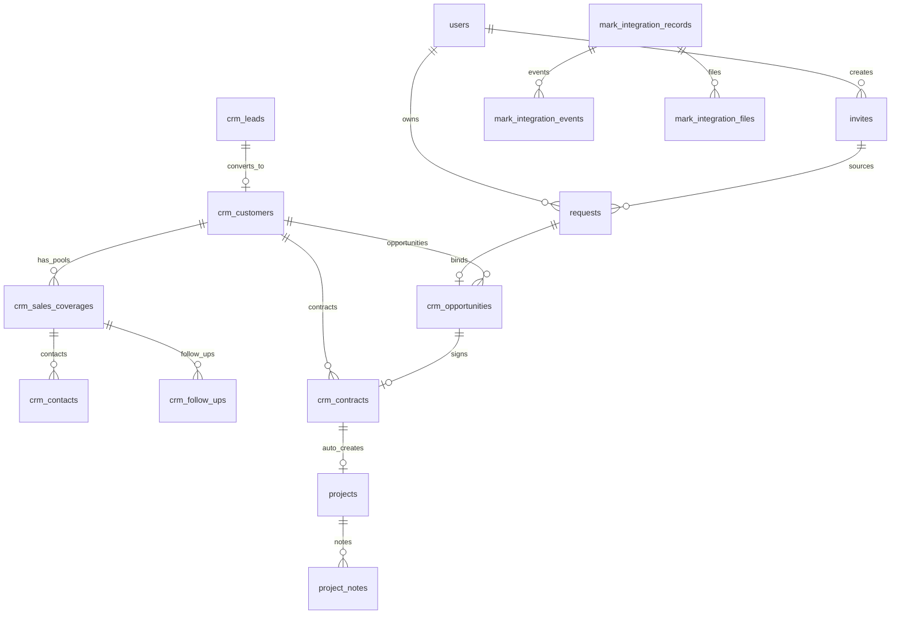

# GEO CRM 数据库设计（MySQL 8.x）

> 库名：`geo_crm` · 字符集：`utf8mb4_unicode_ci` · 引擎：InnoDB  
> Schema 版本：Alembic **`054_lead_source_option_institution`（head）**  
> 最后更新：2026-08-10  
> 阶段说明：见 [`docs/README.md`](../../docs/README.md)；CRM 设计见 [`docs/modules/sales-coverage-isolation-design.md`](../../docs/modules/sales-coverage-isolation-design.md)

---

## 1. 设计原则

| 原则 | 说明 |
|------|------|
| 主键 | 业务实体统一 `CHAR(36)` UUID 字符串（部分明细/日志表用 `VARCHAR(64)`） |
| 时间 | `DATETIME(3)`，应用层 UTC 写入 |
| 灵活字段 | 表单、备注、部门列表用 `JSON`；关键业务字段**已补真实列**（索引/筛选/数据范围校验用列，`document` 仅作扩展兜底） |
| 权限 | RBAC 表（`rbac_*`、`user_role_assignments`、`user_permission_overrides`）为运行时权威；`users.role` 为登录缓存 |
| 登录态 | **JWT 无状态**；`sessions` 表已删除 |
| 部门角色 | `rbac_department_rules`（geo-api 登录与 admin 共用） |
| 飞书通讯录 | **落库快照** + 定时同步，`/sales-colleagues` 优先读库 |
| CRM 主档/对接池 | `crm_customers` 为公司主档；对接明细（联系人/跟进/经营状态）在 `crm_sales_coverages` 及 `crm_contacts` / `crm_follow_ups` 独立表 |
| 数据写穿 | CRM 联系人与跟进先写独立表（033），同时回写 coverage `document`，读路径平滑切换 |

---

## 2. 表一览（30 张）

| 域 | 表名 | 中文名 | 用途 | 写入方 |
|----|------|--------|------|--------|
| 用户 | `users` | 内部用户 | 飞书登录员工 | 登录 upsert / 组织同步 |
| 用户 | `feishu_sales_contacts` | 销售部通讯录快照 | 跟进人/负责人下拉数据源 | 组织定时同步 |
| 用户 | `feishu_sync_logs` | 同步日志 | 通讯录同步审计 | 同步任务 |
| 客户填报 | `invites` | 邀请链接 | 销售发给客户的专属链接 | 销售创建/撤销 |
| 客户填报 | `requests` | 需求单 | 客户填报 + 内部跟进 | 客户提交 / 销售编辑 |
| 打卡 | `checkin_records` | 外勤打卡 | 到达/离开 GPS 记录 | 销售打卡 |
| 项目 | `projects` | 交付项目 | 合同签署后客户成功执行实体 | 合同触发建项 / CS 维护 |
| 项目 | `project_notes` | 项目记录 | 周报/沟通/风险等过程记录 | CS 发布 |
| 项目 | `release_notes` | 版本更新说明 | 管理端弹窗正文 | 发版脚本 upsert |
| RBAC | `rbac_roles` | 角色定义 | 角色与 data_scope | 种子 / 设置页 |
| RBAC | `rbac_permissions` | 权限目录 | 权限码定义 | 种子 / 设置页 |
| RBAC | `rbac_role_permissions` | 角色-权限绑定 | 角色 ↔ 权限码 | 种子 / 设置页 |
| RBAC | `rbac_department_rules` | 部门角色规则 | 飞书部门名 → 默认角色 | Alembic 种子 |
| RBAC | `user_role_assignments` | 用户角色绑定 | 用户 ↔ 角色（含主角色） | 登录 / 授权 |
| RBAC | `user_permission_overrides` | 权限覆盖 | 单用户 grant/deny | 授权 |
| CRM | `crm_leads` | 线索 | 官网/36氪/Mark/自建线索 | 线索创建 / 转客户 |
| CRM | `crm_customers` | 公司主档 | 客户公司档案（无经营状态） | 线索转化 / 自拓建档 |
| CRM | `crm_sales_coverages` | 销售对接池 | 销售-公司 一对多对接明细与经营状态 | 转客户 / 首次跟进自动建池 |
| CRM | `crm_contacts` | 联系人（独立表） | 对接池内联系人（状态化） | 客户新增联系人 / 回填 |
| CRM | `crm_follow_ups` | 跟进记录（独立表） | 对接池内跟进（方式/计划日期） | 客户跟进 |
| CRM | `crm_opportunities` | 商机 | 需求确认后的商机 | 商机创建/编辑 |
| CRM | `crm_contracts` | 合同 | 商机签约后的合同 | 合同创建/编辑/签署 |
| CRM | `crm_audit_records` | 审计记录 | 关键字段/负责人变更审计 | 服务层写审计 |
| CRM | `crm_notifications` | 站内通知 | 待办/提醒消息 | 服务层 / 定时任务 |
| CRM | `lead_source_options` | 线索来源选项 | 会议等二级来源维护 | 会议管理 |
| Mark | `mark_integration_records` | 线索对接台账 | 来源平台 → crmLeadId 映射 | 入站事件 |
| Mark | `mark_integration_nonces` | 防重放 nonce | 签名请求防重放 | 入站事件 |
| Mark | `mark_integration_events` | 入站事件日志 | 全量事件与处理结果 | 入站事件 |
| Mark | `mark_integration_files` | 材料文件 | S3 PDF 下载/校验/重试状态 | 下载 Worker |
| Mark | `mark_review_callbacks` | 审核回传任务 | CRM → Mark 回传队列（指数退避） | 审核动作 / 重试 Worker |

---

## 3. ER 关系



---

## 4. 表结构明细

### 4.1 `users` — 内部用户

| 字段 | 类型 | 空 | 默认 | 说明 |
|------|------|----|------|------|
| `id` | CHAR(36) | N | — | 主键，系统 UUID |
| `feishu_open_id` | VARCHAR(64) | N | — | 飞书 open_id，全局唯一 |
| `name` | VARCHAR(128) | N | — | 显示姓名 |
| `avatar_url` | VARCHAR(512) | Y | NULL | 头像 URL |
| `role` | VARCHAR(32) | N | `sales` | 登录缓存角色（运行时以 RBAC 绑定为准） |
| `role_source` | VARCHAR(16) | N | `auto` | 角色来源：`auto` 自动 / `manual` 人工锁定 |
| `role_locked` | BOOLEAN | N | 0 | 是否锁定角色（不受组织同步覆盖） |
| `data_scope_override` | VARCHAR(16) | Y | NULL | 单用户数据范围覆盖（RBAC 之外） |
| `department_names` | JSON | Y | NULL | 部门名列表，如 `["销售部"]` |
| `department_ids` | JSON | Y | NULL | 所属飞书 `open_department_id` 列表 |
| `manual_department_open_id` | VARCHAR(64) | Y | NULL | 人工指定部门 open_id |
| `manual_department_name` | VARCHAR(128) | Y | NULL | 人工指定部门名 |
| `manual_department_note` | TEXT | Y | NULL | 人工指定说明/审计 |
| `manual_department_leader` | BOOLEAN | N | 0 | 人工标记部门负责人 |
| `feishu_led_department_ids` | JSON | Y | NULL | 飞书部门负责人管辖部门列表 |
| `employment_status` | VARCHAR(16) | N | `active` | `active` 在职 / `resigned` 已离职 |
| `left_at` | DATETIME(3) | Y | NULL | 标记离职时间；在职时为空 |
| `created_at` | DATETIME(3) | N | — | 首次登录时间 |
| `updated_at` | DATETIME(3) | N | — | 最近登录/信息更新时间 |

**索引**：PRIMARY (`id`) · `uk_users_feishu_open_id` (`feishu_open_id`) · `idx_users_employment_status` (`employment_status`)

**离职策略**：离职/冻结/退出时置 `employment_status=resigned`，不删行；需求单 `owner` 姓名快照与 `staff_user_id` 保持不变；离职账号禁止登录，改派不可选。

**组织发现范围**：`FEISHU_ORG_ROOT_DEPARTMENT_IDS` 为发现根；自动合并应用 scopes 可见部门、租户根直属成员与单独授权用户；新成员按部门解析角色，已存在用户登录时校正；多 worker 进程文件锁保证单调度循环。

### 4.2 `invites` — 客户邀请链接

| 字段 | 类型 | 空 | 默认 | 说明 |
|------|------|----|------|------|
| `id` | CHAR(36) | N | — | 主键 |
| `token` | VARCHAR(128) | N | — | 链接 token，客户访问 `/c/{token}` |
| `staff_user_id` | CHAR(36) | N | — | 创建人，`users.id` |
| `label` | VARCHAR(255) | Y | NULL | 备注标签 |
| `geo_variant` | VARCHAR(16) | N | `overseas` | `overseas` 海外 / `domestic` 国内表单 |
| `revoked_at` | DATETIME(3) | Y | NULL | 撤销时间；NULL = 有效 |
| `visit_count` | INT | N | 0 | 链接被访问次数 |
| `created_at` | DATETIME(3) | N | — | 创建时间 |

**索引**：PRIMARY (`id`) · `uk_invites_token` (`token`) · `idx_invites_staff` (`staff_user_id`)

**业务规则**：每人最多 3 个未撤销链接；客户身份为 `geo_invite_token` Cookie，不落 `users` 表；列表返回完整 URL，token 对无权限调用方脱敏。

### 4.3 `requests` — 客户需求单

| 字段 | 类型 | 空 | 默认 | 说明 |
|------|------|----|------|------|
| `id` | CHAR(36) | N | — | 主键 |
| `code` | VARCHAR(32) | N | — | 业务编号，如 `GEO-20260708-A1B2` |
| `status` | VARCHAR(32) | N | — | 状态枚举（见下） |
| `submitted_at` | DATETIME(3) | Y | NULL | 提交时间；草稿为 NULL |
| `updated_at` | DATETIME(3) | N | — | 最后更新时间 |
| `owner` | VARCHAR(128) | N | — | 跟进人姓名（展示） |
| `staff_user_id` | CHAR(36) | Y | NULL | 归属销售；`NULL` = 未分配 |
| `invite_id` | CHAR(36) | Y | NULL | 来源邀请 `invites.id` |
| `opportunity_id` | CHAR(36) | Y | NULL | 绑定商机 |
| `data` | JSON | N | — | 客户表单全量数据 |
| `notes` | JSON | N | `[]` | 内部备注列表 |
| `attachments` | JSON | N | `[]` | 附件列表（url/storagePath 等） |

**`status` 枚举**（v1.1.0-staging.28 语义对齐后）：

| 值 | 含义 |
|----|------|
| `draft` | 保存草稿 |
| `submitted` | 客户已提交 |
| `pending_review` | 待销售确认 |
| `confirmed` | 待绑定商机 |
| `in_project` | 已绑定商机 |
| `supplement` / `closed` / `reviewing` / `approved` / `rejected` | 历史遗留兼容值（仅保证存量数据渲染，不进需求管理筛选/动作） |

> 状态码/文案/tone 的唯一权威源：`geo-api/app/modules/contracts/status_catalog.py`（前后端由生成器同步，`tests/test_request_status_contract_parity.py` 钉死后端 Literal ↔ 目录一致）。

**索引**：PRIMARY (`id`) · `uk_requests_code` (`code`) · `idx_requests_status` · `idx_requests_submitted_at` · `idx_requests_staff_user` · `idx_requests_opportunity` · `idx_requests_invite` (`invite_id`)

### 4.4 RBAC 表组

#### `rbac_roles` — 角色定义

| 字段 | 类型 | 说明 |
|------|------|------|
| `id` | CHAR(36) | 主键 |
| `code` | VARCHAR(64) | 角色码（`sales` / `leader` / `ops` / `marketing` 等） |
| `name` | VARCHAR(128) | 显示名 |
| `description` | VARCHAR(512) | 说明 |
| `data_scope` | VARCHAR(16) | `own` / `department` / `all` |
| `is_system` | BOOLEAN | 系统内置角色（不可删） |
| `sort_order` | INT | 排序 |
| `created_at` / `updated_at` | DATETIME | 时间戳 |

#### `rbac_permissions` — 权限目录

| 字段 | 类型 | 说明 |
|------|------|------|
| `code` | VARCHAR(64) | 权限码，如 `customers:write` |
| `name` | VARCHAR(128) | 显示名 |
| `module` | VARCHAR(64) | 所属模块 |
| `sort_order` | INT | 排序 |
| `created_at` / `updated_at` | DATETIME | 时间戳 |

#### `rbac_role_permissions` — 角色-权限绑定

| 字段 | 类型 | 说明 |
|------|------|------|
| `role_id` | VARCHAR(36) | 角色 ID |
| `permission_code` | VARCHAR(64) | 权限码 |

#### `rbac_department_rules` — 部门默认角色

| 字段 | 类型 | 说明 |
|------|------|------|
| `department_name` | VARCHAR(191) | 飞书部门名（主键之一） |
| `role_code` | VARCHAR(64) | 默认角色 code（主键之一） |
| `sort_order` | INT | 匹配优先级 |

#### `user_role_assignments` — 用户角色绑定

| 字段 | 类型 | 说明 |
|------|------|------|
| `user_id` | VARCHAR(36) | 用户 |
| `role_id` | VARCHAR(36) | 角色 |
| `is_primary` | BOOLEAN | 是否主角色（单身份收敛后唯一主角色） |
| `assigned_at` / `created_at` / `updated_at` | DATETIME | 时间戳 |

#### `user_permission_overrides` — 单用户权限覆盖

| 字段 | 类型 | 说明 |
|------|------|------|
| `user_id` | VARCHAR(36) | 用户 |
| `permission_code` | VARCHAR(64) | 权限码 |
| `granted` | BOOLEAN | true=授予 / false=拒绝 |
| `created_at` / `updated_at` | DATETIME | 时间戳 |

> 权限码三处目录（前端 `rbac-seed-data.ts` / 种子 `seed_rbac.py` / 回退 `permissions.py`）由 `scripts/check_rbac_alignment.py` 与 pytest 钉死一致；管理员/超管由目录全量派生，不得按角色硬编码。

### 4.5 `feishu_sales_contacts` — 销售部通讯录快照

| 字段 | 类型 | 空 | 默认 | 说明 |
|------|------|----|------|------|
| `feishu_open_id` | VARCHAR(64) | N | — | 主键，飞书 open_id |
| `name` | VARCHAR(128) | N | — | 姓名 |
| `job_title` | VARCHAR(128) | Y | NULL | 职位 |
| `department_ids` | JSON | Y | NULL | 所属部门 open_department_id |
| `department_names` | JSON | Y | NULL | 部门名列表 |
| `is_active` | TINYINT(1) | N | 1 | 1=在职可用，0=已离职/移出部门 |
| `synced_at` / `created_at` / `updated_at` | DATETIME(3) | — | — | 同步/创建/更新时间 |

**索引**：PRIMARY (`feishu_open_id`) · `idx_fsc_active_name` (`is_active`, `name`)

### 4.6 `feishu_sync_logs` — 同步任务日志

| 字段 | 类型 | 说明 |
|------|------|------|
| `id` | CHAR(36) | 主键 |
| `job_name` | VARCHAR(64) | 任务名，如 `sales_contacts` |
| `status` | VARCHAR(32) | `success` / `failed` |
| `record_count` | INT | 同步条数 |
| `error_message` | TEXT | 失败原因 / 明细 JSON |
| `started_at` / `finished_at` | DATETIME(3) | 起止时间 |

**索引**：PRIMARY (`id`) · `idx_fsl_job_started` (`job_name`, `started_at`)

### 4.7 `checkin_records` — 外勤打卡

| 字段 | 类型 | 说明 |
|------|------|------|
| `id` | CHAR(36) | 主键 |
| `user_id` / `user_name` | CHAR(36) / VARCHAR(128) | 打卡人 |
| `department_names` | TEXT | 部门名快照 |
| `visit_id` | CHAR(36) | 拜访会话 ID（到达/离开配对） |
| `type` | VARCHAR(16) | `arrive` / `leave` |
| `timestamp` | BIGINT | 客户端时间戳（毫秒） |
| `beijing_time` | VARCHAR(32) | 北京时间展示字符串 |
| `latitude` / `longitude` / `accuracy` | FLOAT | GPS 与精度 |
| `address` | TEXT | 逆地理编码地址 |
| `province` / `city` / `district` | VARCHAR(64) | 行政区划 |
| `attachment_ids` | TEXT | 兼容字段：附件 ID JSON 数组 |
| `attachments` | JSON | 结构化附件（url/storagePath 等） |
| `created_at` | DATETIME | 服务端写入时间 |

**索引**：PRIMARY (`id`) · `ix_checkin_records_user_id` · `ix_checkin_records_visit_id` · `ix_checkin_records_timestamp`

> 二进制文件存本地目录 `CHECKIN_ATTACHMENTS_DIR`；数据库只存记录与附件链接/元数据。

### 4.8 `projects` — 交付项目（migration `018` + `022`）

| 字段 | 类型 | 说明 |
|------|------|------|
| `id` | CHAR(36) PK | |
| `name` | VARCHAR(255) | 项目名称 |
| `customer_id` / `customer_name` | CHAR(36) / VARCHAR(255) | 客户引用 + 名称快照 |
| `source_contract_id` | CHAR(36) UK | 来源合同；一合同一项目 |
| `opportunity_id` | CHAR(36) | 可选商机 |
| `geo_source` | VARCHAR(16) | 国内/海外归属（`022`） |
| `stage` / `health` / `risk_level` | VARCHAR | 阶段 / 健康度 / 风险 |
| `biz_owner*` / `project_manager*` / `executor*` / `content_ops*` | VARCHAR(128) + `*_user_id` | 人员姓名 + 可选用户 ID |
| `contract_amount` | DECIMAL(14,2) | 金额快照 |
| `customer_industry` / `type` / `region` | VARCHAR | 客户属性快照 |
| `project_types` / `platforms` | JSON | 类型与平台 |
| `intent_brand` / `intent_content` / `intent_search` | INT | 意图数 |
| `kpi_notes` / `delay_reason` | TEXT | |
| `start_date` / `sow_end_date` | DATE | |
| `created_at` / `updated_at` / `archived_at` | DATETIME | |
| `created_by` / `updated_by` | VARCHAR(128) | 姓名快照 |

### 4.9 `project_notes` — 项目过程记录

| 字段 | 类型 | 说明 |
|------|------|------|
| `id` | CHAR(36) PK | |
| `project_id` | CHAR(36) 索引 | 所属项目 |
| `kind` | VARCHAR(32) | 周报/沟通/执行/风险/下一步等 |
| `content` | TEXT | |
| `created_at` | DATETIME | |
| `created_by` / `created_by_user_id` | VARCHAR(128) / CHAR(36) | 姓名 + 用户 ID |

### 4.10 `crm_leads` — 线索（`012` + `031`）

| 字段 | 类型 | 说明 |
|------|------|------|
| `id` | CHAR(36) PK | |
| `owner_user_id` | VARCHAR(36) | 归属销售；`NULL` 未分配（仅 Leader+/管理员可见） |
| `status` | VARCHAR(32) | 线索状态 |
| `company_name` | VARCHAR(255) | 公司名 |
| `source` | VARCHAR(128) | 一级来源（`031` 补列） |
| `source_detail` | VARCHAR(255) | 二级来源（`031` 补列） |
| `level` | VARCHAR(32) | 等级（`031` 补列） |
| `region` | VARCHAR(128) | 地区（`031` 补列） |
| `first_contact_date` | DATE | 首次联系日期（`031` 补列） |
| `contact_name` | VARCHAR(255) | 联系人姓名（`031` 补列） |
| `document` | JSON | 全量业务字段（扩展兜底） |
| `created_at` / `updated_at` | DATETIME | |

**索引**：`idx_crm_leads_owner` · `idx_crm_leads_status` · `idx_crm_leads_source` · `idx_crm_leads_source_detail` · `idx_crm_leads_level` · `idx_crm_leads_region`

### 4.11 `crm_customers` — 公司主档（`012` + `023` + `031`）

| 字段 | 类型 | 说明 |
|------|------|------|
| `id` | CHAR(36) PK | |
| `owner_user_id` | VARCHAR(36) | 建档销售（主档归属；可见性以对接池为准） |
| `status` | VARCHAR(32) | 兼容字段（经营状态已迁至 coverage） |
| `company_name` | VARCHAR(255) | 公司名 |
| `credit_code` | VARCHAR(64) | 统一信用代码（`031` 补列，查重/索引） |
| `region` | VARCHAR(128) | 地区（`031` 补列） |
| `document` | JSON | 全量业务字段 |
| `created_at` / `updated_at` | DATETIME | |

**索引**：`idx_crm_customers_owner` · `idx_crm_customers_status` · `idx_crm_customers_credit_code` · `idx_crm_customers_region`

### 4.12 `crm_sales_coverages` — 销售对接池（`023`）

| 字段 | 类型 | 说明 |
|------|------|------|
| `id` | CHAR(36) PK | |
| `customer_id` | VARCHAR(36) | 公司主档 |
| `owner_user_id` | VARCHAR(36) | 对接销售 |
| `status` | VARCHAR(32) | 池经营状态（`awaiting_contact` 等） |
| `owner_name` | VARCHAR(255) | 负责人姓名快照（`031` 补列） |
| `last_follow_at` | DATE | 最近跟进（`031` 补列） |
| `next_follow_at` | DATE | 下次跟进（`031` 补列） |
| `document` | JSON | 联系人/跟进等扩展字段（写穿镜像） |
| `created_at` / `updated_at` | DATETIME | |

**索引/约束**：`uq_crm_sales_coverages_customer_owner` (`customer_id`, `owner_user_id`) · `idx` (`customer_id`) · `idx` (`owner_user_id`) · `idx` (`status`)

### 4.13 `crm_contacts` — 联系人独立表（`033`）

| 字段 | 类型 | 说明 |
|------|------|------|
| `id` | VARCHAR(64) PK | |
| `coverage_id` | VARCHAR(36) | 所属对接池（索引） |
| `customer_id` | VARCHAR(36) | 公司主档（索引） |
| `name` | VARCHAR(255) | 姓名 |
| `title` | VARCHAR(128) | 职位 |
| `phone` / `wechat` / `email` | VARCHAR | 联系方式 |
| `status` | VARCHAR(32) | `待建联/已建联/商机跟进/已合作/停止跟进`（索引） |
| `is_primary` / `active` / `wechat_added` | BOOLEAN | 主联系人/启用/微信已加 |
| `source` / `source_detail` | VARCHAR | 一级/二级来源 |
| `source_lead_id` | VARCHAR(36) | 回填来源线索 |
| `created_at` / `updated_at` | DATETIME | |

**索引**：`idx_crm_contacts_coverage` · `idx_crm_contacts_customer` · `idx_crm_contacts_status`

### 4.14 `crm_follow_ups` — 跟进记录独立表（`033`）

| 字段 | 类型 | 说明 |
|------|------|------|
| `id` | VARCHAR(64) PK | |
| `coverage_id` | VARCHAR(36) | 所属对接池（索引） |
| `customer_id` | VARCHAR(36) | 公司主档（索引） |
| `author` | VARCHAR(128) | 跟进人姓名快照 |
| `content` | TEXT | 内容 |
| `follow_type` | VARCHAR(32) | 线上沟通/线下拜访等 |
| `wechat_added` | BOOLEAN | 是否已加微信 |
| `mentions` | JSON | @提及 |
| `next_follow_at` | DATE | 计划下次跟进 |
| `created_at` / `updated_at` | DATETIME | |

**索引**：`idx_crm_follow_ups_coverage` · `idx_crm_follow_ups_customer`

> 033 为写穿镜像：创建/保存 coverage 时同步写独立表，读路径暂仍以 `document` 为主，后续查询/统计可平滑切表。

### 4.15 `crm_opportunities` — 商机（`012` + `031`）

| 字段 | 类型 | 说明 |
|------|------|------|
| `id` | CHAR(36) PK | |
| `owner_user_id` | VARCHAR(36) | 归属销售 |
| `customer_id` | VARCHAR(36) | 客户 |
| `stage` | VARCHAR(32) | 阶段（索引） |
| `amount` | NUMERIC(18,2) | 金额（`031` 补列） |
| `expected_sign_date` | DATE | 预计签约日期（`031` 补列） |
| `document` | JSON | 全量业务字段 |
| `created_at` / `updated_at` | DATETIME | |

**索引**：`idx_crm_opps_owner` · `idx_crm_opps_customer` · `idx_crm_opps_stage`

### 4.16 `crm_contracts` — 合同（`012` + `031`）

| 字段 | 类型 | 说明 |
|------|------|------|
| `id` | CHAR(36) PK | |
| `owner_user_id` | VARCHAR(36) | 归属销售 |
| `customer_id` | VARCHAR(36) | 客户 |
| `status` | VARCHAR(32) | 状态（索引） |
| `amount` | NUMERIC(18,2) | 金额（`031` 补列） |
| `document` | JSON | 全量业务字段 |
| `created_at` / `updated_at` | DATETIME | |

**索引**：`idx_crm_contracts_owner` · `idx_crm_contracts_customer` · `idx_crm_contracts_status`

### 4.17 `crm_audit_records` — 审计记录（`013`）

| 字段 | 类型 | 说明 |
|------|------|------|
| `id` | VARCHAR(64) PK | |
| `module` | VARCHAR(32) | 模块（索引） |
| `entity_type` / `entity_id` | VARCHAR | 实体类型与 ID（`entity_id` 索引） |
| `related_entity_ids` | JSON | 关联实体 |
| `entity_name` | VARCHAR(255) | 实体名快照 |
| `action` | VARCHAR(128) | 动作 |
| `actor` / `actor_user_id` | VARCHAR | 操作人（`actor_user_id` 索引） |
| `timestamp_at` | DATETIME | 业务时间（索引） |
| `changes` | JSON | 变更明细 |
| `created_at` | DATETIME | |

**索引**：`idx_crm_audit_module` · `idx_crm_audit_entity` · `idx_crm_audit_actor` · `idx_crm_audit_ts`

### 4.18 `crm_notifications` — 站内通知（`014`）

| 字段 | 类型 | 说明 |
|------|------|------|
| `id` | VARCHAR(64) PK | |
| `target_name` / `target_user_id` | VARCHAR | 接收人（`target_user_id` 索引） |
| `actor` / `actor_user_id` | VARCHAR | 触发人 |
| `message` | VARCHAR(512) | 文案 |
| `href` | VARCHAR(512) | 跳转链接 |
| `is_read` | BOOLEAN | 已读 |
| `created_at` | DATETIME | 索引 |

### 4.19 `lead_source_options` — 线索来源选项（`028` + `029`）

| 字段 | 类型 | 说明 |
|------|------|------|
| `id` | CHAR(36) PK | |
| `primary_source` | VARCHAR(64) | 一级来源（索引；`(primary_source, name)` 唯一） |
| `start_date` | DATE | 会议日期（`029`，索引） |
| `name` | VARCHAR(128) | 会议名称 |
| `organizer` | VARCHAR(128) | 主办方 |
| `enabled` | BOOLEAN | 是否启用 |
| `sort_order` | INT | 排序 |
| `updated_by` | VARCHAR(36) | 更新人 |
| `deleted_by` / `deletion_reason` / `deleted_at` | VARCHAR / TEXT / DATETIME | 软删除审计（`deleted_at` 索引） |
| `created_at` / `updated_at` | DATETIME | |

### 4.20 Mark 集成表组（`024`–`026`）

#### `mark_integration_records` — 线索对接台账

| 字段 | 类型 | 说明 |
|------|------|------|
| `id` | CHAR(36) PK | |
| `platform` | VARCHAR(32) | `website` / `36kr` / `mark` |
| `external_record_id` | VARCHAR(128) | 平台侧记录 ID（`(platform, external_record_id)` 唯一） |
| `crm_lead_id` | VARCHAR(36) | CRM 线索 ID |
| `last_event_id` | VARCHAR(64) | 最近事件 ID |
| `created_at` / `updated_at` | DATETIME | |

#### `mark_integration_nonces` — 防重放 nonce

| 字段 | 类型 | 说明 |
|------|------|------|
| `id` | CHAR(36) PK | |
| `platform` | VARCHAR(32) | 平台 |
| `nonce` | VARCHAR(128) | 请求唯一值（`(platform, nonce)` 唯一） |
| `request_timestamp` | DATETIME | 请求时间 |
| `created_at` | DATETIME | |

#### `mark_integration_events` — 入站事件日志

| 字段 | 类型 | 说明 |
|------|------|------|
| `id` | CHAR(36) PK | |
| `platform` | VARCHAR(32) | 平台 |
| `event_id` | VARCHAR(64) | 事件 ID（`(platform, event_id)` 唯一） |
| `event_type` | VARCHAR(64) | 事件类型 |
| `external_record_id` | VARCHAR(128) | 平台侧记录 ID（索引） |
| `payload_hash` | VARCHAR(64) | 载荷哈希（幂等判定） |
| `process_status` | VARCHAR(32) | 处理状态 |
| `response_json` | JSON | 处理结果 |
| `received_at` / `processed_at` | DATETIME | |

#### `mark_integration_files` — 材料文件（S3 下载）

| 字段 | 类型 | 说明 |
|------|------|------|
| `id` | CHAR(36) PK | |
| `platform` / `external_record_id` / `crm_lead_id` | VARCHAR | 归属（`external_record_id` 索引） |
| `external_file_id` / `file_version` | VARCHAR | 平台侧文件 ID 与版本 |
| `original_name` / `content_type` | VARCHAR | 文件名/类型 |
| `source_url` / `url_expires_at` | TEXT / DATETIME | S3 地址与过期时间 |
| `expected_size` / `expected_checksum` | BIGINT / VARCHAR(64) | 校验期望（大小 + SHA-256） |
| `size` / `checksum` / `storage_path` | — | 下载结果 |
| `download_status` | VARCHAR(32) | `pending_download` 等（索引） |
| `failure_reason` / `download_attempts` / `next_attempt_at` | — | 重试状态 |
| `is_current` | BOOLEAN | 是否当前版本（索引） |
| `generated_at` / `uploaded_at` / `remark` | — | 生成/上传时间与备注 |

#### `mark_review_callbacks` — 审核回传队列（`025`）

| 字段 | 类型 | 说明 |
|------|------|------|
| `id` | CHAR(36) PK | |
| `event_id` | VARCHAR(64) | 回传事件 ID（唯一/索引） |
| `external_record_id` | VARCHAR(128) | 平台记录 ID（索引） |
| `crm_lead_id` | VARCHAR(36) | 线索（索引） |
| `payload` | JSON | 回传载荷 |
| `status` | VARCHAR(32) | `pending` 等（索引） |
| `attempts` / `next_attempt_at` / `last_error` / `sent_at` | — | 指数退避重试状态 |
| `created_at` / `updated_at` | DATETIME | |

### 4.21 `release_notes` — 版本更新说明（`019`）

| 字段 | 类型 | 说明 |
|------|------|------|
| `id` | CHAR(36) PK | |
| `version` | VARCHAR(64) | Git tag / APP_VERSION（唯一索引） |
| `title` | VARCHAR(255) | 弹窗标题 |
| `body` | TEXT | 用户可见正文 |
| `published_at` / `created_at` / `updated_at` | DATETIME | 时间戳 |

---

## 5. 不落库的数据

| 数据 | 处理方式 |
|------|----------|
| JWT Access Token | 客户端 Cookie / Bearer，验签即可 |
| 运行时 permissions | 由 `rbac_*` 表 + 覆盖计算；`app/modules/auth/permissions.py` 仅作角色行缺失时回退 |
| 飞书 tenant_token | 优先 Redis（若启用）；否则进程内存；见 `docs/modules/redis-cache.md` |
| Redis 缓存 | **非权威**；可关 / 可未部署，回源 MySQL |
| 客户浏览器 invite cookie | `geo_invite_token`，不映射 users 表 |
| 打卡附件二进制 | 本地磁盘；**链接与元数据**在 `checkin_records.attachments` |

---

## 6. 迁移与运维

```bash
# 初始化 / 升级
cd geo-api && alembic upgrade head

# 手动同步通讯录（users + feishu_sales_contacts，与进程内定时任务相同）
python scripts/sync_feishu_sales_contacts.py
```

**迁移链（001–033）**

```text
001_initial → 002_feishu_contacts → 003_rbac → 004_feishu_contact_title
→ 005_directory_department_profiles → 006_checkin_records → 007_checkin_ts_bigint
→ 008_schema_hardening → 009_checkin_view_team_permission → 010_user_employment_status
→ 011_checkin_attachments_json → 012_crm_entities → 013_crm_audit_records
→ 014_crm_notifications → 015_request_opportunity_binding → 016_users_department_ids
→ 017_request_attachments → 018_projects → 019_release_notes → 020_invite_geo_variant
→ 021_feishu_led_department_ids → 022_project_geo_source → 023_crm_sales_coverages
→ 024_mark_integration → 025_lead_integration_hardening → 026_mark_download_retry
→ 027_marketing_rbac → 028_lead_source_options → 029_lead_source_meeting_details
→ 030_sdr_dashboard_without_customers → 031_crm_business_columns → 032_rbac_timestamps
→ 033_crm_contacts_follow_ups（head）
```

发版时含迁移的 tag：部署脚本会自动 `alembic upgrade head`（见 `docs/ops/deploy.md`）；RBAC 种子变更需重跑 `geo-api/scripts/seed_rbac.py`。

---

## 7. 后续可扩展

| 扩展 | 状态 |
|------|------|
| CRM 联系人与跟进读路径切独立表 | 独立表已建（033）为写穿镜像；读路径暂以 document 为主，可平滑切换 |
| 项目管理 P3（历史 backfill、通知等） | 未实施；见 `docs/modules/projects.md` |
| 生产启用 Redis | 代码已有；北京现网未部署容器 |
| 需求单状态历史表 | 未实施 |
